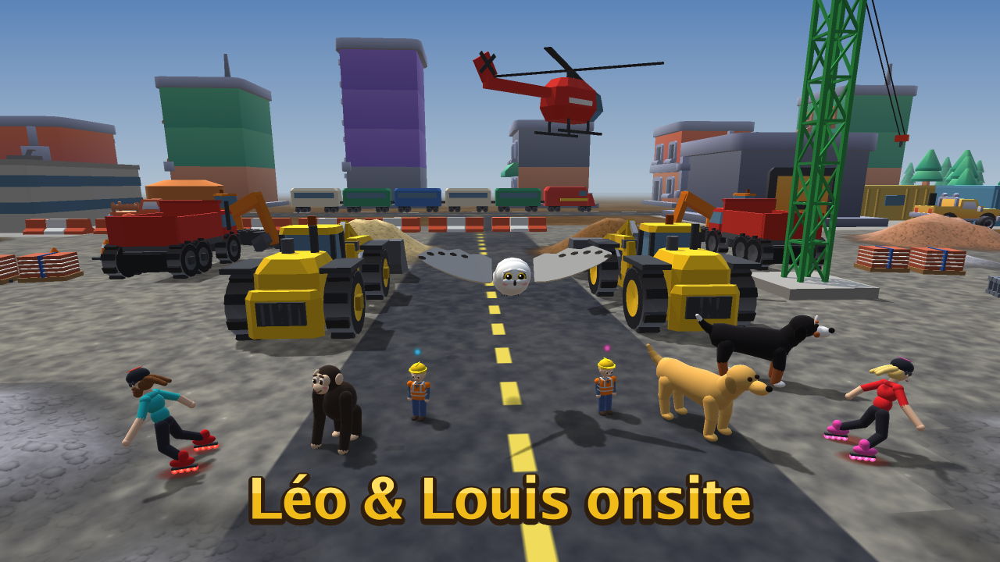

# Wheel Loader — Construction Site



A **3D** construction-site game for two small kids on one keyboard. Each kid
has their own **articulated wheel loader**, dump truck and tower crane, and
plays with four direction keys and one button. Built in Go with
[raylib-go](https://github.com/gen2brain/raylib-go).

Each frame the mesh builders (`g3d.go`, `shapes.go`) build the world as
3D triangles, and the **GPU renderer** (`gpu.go`) draws them with OpenGL: a
depth buffer, per-pixel lighting (sun plus sky/ground ambient and a soft rim
light), a soft sun **shadow map** so everything casts real shadows, distance
fog, a sky gradient, and 2×2 supersampling for smooth edges. Everything —
the loader, trucks, buildings, aggregate heaps — is actual 3D geometry you
orbit around.

- **Aggregate heaps** are a continuous heightfield mesh built from the
  material grid each frame, smoothed, shaded and textured with a seamless
  procedural grain, so digging and dumping visibly reshape them.
- **Machines** are lofted from chamfered cross-sections: tapered hood,
  counterweight and grille, cab on the rear frame, lift arms with cylinders
  and Z-bar linkage, a U-shaped toothed bucket, and lugged tyres that turn.
- **Scenery** mixes procedural props with free **Kenney CC0 models** (houses,
  a workshop garage, pickups, trees) loaded by a small built-in glTF/GLB
  reader (`model.go`).

Under the simple controls the machines are properly simulated: the loader
has heavy-machine inertia, articulated (frame) steering that bends at the
centre joint, and a bucket (lift + tilt) that scoops, carries, dumps, pushes
and spills loose material; the helpers in `toddler.go` work the bucket, the
dump body and the crane hook for the kids.

## Running

On Linux, clone it and run the script; it installs what is missing, builds
and starts the game:

```sh
git clone https://github.com/lmis/wheel-loader.git
cd wheel-loader
./run.sh
```

Next time just run `./run.sh` again (it only rebuilds when the code
changed). Elsewhere, or by hand:

```sh
go run .
```

A resizable window opens at 1280×720. You need OpenGL 3.3. On Linux the
build compiles raylib with cgo and needs the GL/X11 headers:

```sh
sudo apt install libgl1-mesa-dev libxi-dev libxcursor-dev libxrandr-dev \
  libxinerama-dev libwayland-dev libxkbcommon-dev
```

On a headless Linux box, run under `xvfb-run` with `LIBGL_ALWAYS_SOFTWARE=1`
(slow, but the screenshot modes work).

## How to play

The game starts in **single-screen play** for one kid, made for a laptop
keyboard with picture keycaps. These are the only keys that do anything:

| Key | What it does |
| --- | --- |
| ↑ / ↓ | Drive forward / back up |
| ← / → | Steer left / right while driving forward (one key goes round a corner) |
| Space | The machine's one thing: lift or tip the loader's bucket, tip the dump truck, dig once with the excavator, pick up or drop with the crane |
| Shift | Climb out and walk over to the next machine (loader → truck → crane → excavator) |
| 1 2 3 4 | Go to the loader, truck, crane or excavator |
| V | Cab view / chase camera |

On the crane, ← → swing the jib and ↑ ↓ run the hook out and in. There is
no pause and nothing else to press. Only the kid's own four machines are on
the site. The animal friends come along: the owl and the chimp, or start
with `./run.sh --doggo` for the two dogs (`--owl` is the default).

### Split screen

`./run.sh --split-screen` puts two kids side by side on one keyboard, each
with their own machines and animals. Everything plays exactly as in single
screen; only the keys differ:

| | Player 1 (left) | Player 2 (right) |
| --- | --- | --- |
| Drive / steer (crane: swing and trolley) | `W` `A` `S` `D` | arrow keys |
| The machine's one thing | `Space` | `Enter` |
| Next machine | `Left Shift` | `Right Shift` |
| Pick loader / truck / crane / excavator | `1` `2` `3` `4` | `8` `9` `0` `-` |
| Cab view / chase camera | `V` | `M` |

The view key switches between the chase camera and looking
out of the cab: the loader's dashboard, steering wheel and windscreen frame
with the arms and bucket ahead, the truck's wheel and dash, and the crane
cab's desk, screens and joysticks above its glass floor, looking down at the
hook. Picking a machine makes the kid stop, climb out, walk over
(round anything in the way) and climb in; there is no other way out. The
machines do the fiddly parts themselves:

- **Loader:** drive (or turn) into the heap and the bucket fills. The
  button lifts it (nothing else does); drive up to the truck with it raised
  and it tips in, or press the button again to tip it out anywhere, and it
  lowers itself.
- **Dump truck:** the button tips the body all the way, the load pours out,
  and the body comes back down.
- **Crane:** a snappy toy. Left/right swings the jib, up/down runs the
  trolley out and in. Swing near a load and the hook homes in, drops, hooks
  on and lifts; carry it near your truck and it homes in over the bed and
  sets it down (in single-screen play it waits for space). The button lowers
  the hook by hand anywhere.
- **Excavator:** the direction keys drive the tracks; one press of the
  button digs: reach out in front, fill the bucket, lift, swing to your
  truck if it is in reach (or out to the side), tip it in and swing back.

Each truck takes about five bucket loads before it is full; it stays full
until its kid drives it somewhere and tips it out (and the new heap can be
scooped up again). The machines are speed-limited and stop when no key is
held.

The kids are site workers in orange hi-vis vests and yellow hard hats, with
blonde hair and brown eyes. Each kid has two animal friends who ride on
their machine: a snowy owl and a small chimp for player 1, a golden
retriever and a Bernese mountain dog for player 2. When the kid switches
machines, the animals hop down, run along beside them (the owl flies), and
hop up onto the next machine: on the cab roof and the engine hood of the
loader, on the truck's cab roof, and on the crane's footing. An excavator, a
third dump truck and three Kenney pickups stand parked around the site.

## A little wonder

Things happen around the site just to look at:

- **The animals** bounce up and down on the spot every couple of seconds
  (the owl flaps its wings).
- **A train** of a red locomotive and five coloured carriages runs along a
  line in the distance, between the north road and the houses, every so
  often. It stops and waits if anything is standing on the track.
- **A red helicopter** flies low over the middle of the site now and then,
  rotors spinning, its shadow sweeping across the ground.
- **A rollerblader** laps the roads at speed, right down the road between
  the two kids: dark helmet, long brown hair streaming behind, blue
  glasses, and red rollerblades whose wheels glow and leave a red trail. He
  swerves round anything in his way. Once a lap he rolls off the road onto
  the site between the kids, stops, has a good look around, and skates on.

They are in `wonder.go`.

## Material simulation

Loose material is a coarse height grid (`material.go`). Scooping removes amount
from cells under the bucket edge; dumping deposits it (into a truck bed if one
is underneath, otherwise onto the ground where it slumps); pushing bulldozes
material between cells; a badly tilted bucket spills its load. Buckets can be
partially filled and loads carry their material type.

## Project layout

| File | Responsibility |
| --- | --- |
| `game.go` | Main loop, fixed-timestep update, effect spawning |
| `loader.go` | Articulated loader kinematics, dynamics, bucket interaction |
| `material.go` | Loose-material height grid (scoop / dump / push / slump) |
| `world.go` | Site layout, collision, trucks, particles |
| `vehicle.go` | `Vehicle` interface, controls, the loader as a vehicle |
| `truck.go`, `excavator.go`, `crane.go`, `car.go` | The other machines |
| `cargo.go` | Crane loads: falling, stacking, riding on trucks |
| `shapes.go` | Smooth shapes: ellipsoids, capsules, rounded lofts, spots |
| `studio.go` | Character studio: contact sheets of every pose from four angles |
| `wonder.go` | The train, the helicopter and the rollerblader |
| `toddler.go` | Toddler mode: tiny controls, machine assistants, walking over |
| `walker.go` | The kid on foot |
| `animals.go` | The dogs, the chimp and the owl: riding, following, hopping |
| `player.go` | Players, getting in and out, cameras |
| `g3d.go` | Scene of world-space triangles and the mesh builders |
| `gpu.go` | GPU renderer: shaders, shadow map, supersampled views |
| `camera.go` | Perspective chase/orbit camera |
| `input.go` | Keyboard → player controls |
| `render.go` | Builds the 3D scene (ground, loader, props, trucks, particles) |
| `art.go` | Procedural ground/dirt textures, grain atlas, fonts, noise |
| `model.go` | Minimal glTF/GLB loader for the embedded Kenney models |
| `hud.go` | 2D drawing helpers (text, panels), pause notice |
| `main.go` | Entry point, screenshot modes |

Simulation, input and rendering are kept separate. The update step is a fixed
1/60 s so physics is stable regardless of frame rate.

## Developer modes

```sh
go run . -scenes ./shots    # headless: stage and capture every feature (split screen)
go run . -single-scenes ./shots  # headless: capture single-screen play
go run . -scenes ./shots -only crane  # just the scenes whose name matches
go run . -tour ./shots      # headless: static views of site landmarks
go run . -studio ./shots    # headless: contact sheets of every character in every pose
go run . -cover cover.png   # headless: the cover art, Léo & Louis onsite
go run . -cpuprofile cpu.prof  # write a CPU profile (combine with any mode)
```

Screenshot modes print the triangle count and smoothed CPU time per frame.

## Assets and credits

All graphics are procedural except the models in `assets/kenney/`, which are by
[Kenney](https://kenney.nl) under **CC0 1.0** (public domain), taken from the
[Starter Kit City Builder](https://github.com/KenneyNL/Starter-Kit-City-Builder)
and [Starter Kit Racing](https://github.com/KenneyNL/Starter-Kit-Racing)
repositories. They are embedded into the binary. See `assets/kenney/LICENSE.txt`.

## Tests

```sh
go test ./...   # driving, scooping, dumping, entering/exiting, truck tipping,
                # excavator dig-and-load, crane lift onto a truck,
                # toddler mode: loading, tipping, crane lifts, walking over,
                # the animals riding and coming along
go vet ./...
```
